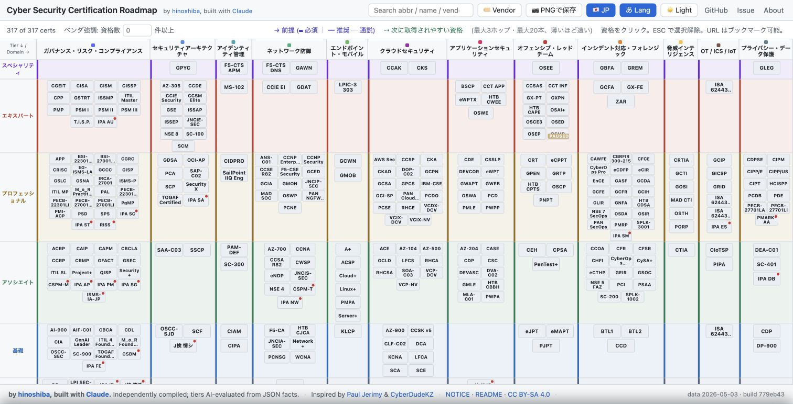
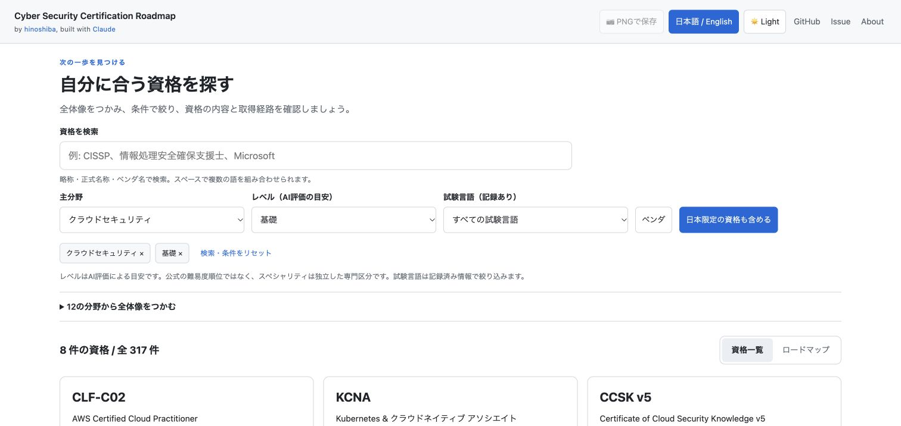
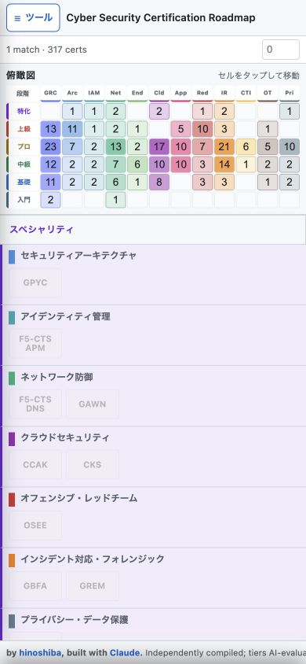
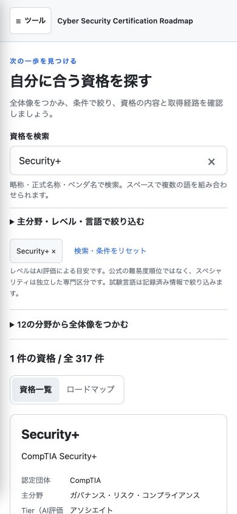

# 資格探索 UI の調査・改善記録

調査日: 2026-10-12。基準リビジョン: `779eb43`。対象: [公開サイトの日本語・ライト・日本資格込み表示](https://www.hinoshiba.com/CyberSecurityCertificationRoadmap/?theme=light&lang=ja&jp=1)。

本記録は、公開一次資料、リポジトリ文書・コード、実ブラウザ担当の操作記録を組み合わせたデスク調査である。実利用者へのインタビュー、アンケート、利用ログ分析は実施していない。以下の利用者像は検証すべき仮説であり、利用者全体の意見や実測した満足度を表さない。ローカル検証の結果と限界は末尾に記載する。CI 結果は PR チェック欄を参照する。

## 目的と根拠

作者の[公開記事](https://zenn.dev/hinoshiba/articles/made-cybersecurity-certification-roadmap)（2026-05-03、今回全文確認）は、若手・学生からのキャリア相談を制作の契機として説明している。国内外の資格を同じ図で比較し、取得済み資格や目標資格から前後の候補を探すことが目的である。作者は Tier の厳密な順位より、大枠の方向性を把握することを重視している。したがって、検索だけで図を置き換えるのではなく、読める候補一覧と既存の位置関係を行き来できることを優先する。

[NIST NICE](https://www.nist.gov/itl/applied-cybersecurity/nice/nice-framework-resource-center) は職務の理解、教育・訓練、キャリア設計を用途として挙げ、[キャリア経路資料](https://www.nist.gov/itl/applied-cybersecurity/nice/resources/cyber-careers)では職務・移行先・スキル・資格を関連付けた探索例を紹介している。[IPA のシラバス説明](https://www.ipa.go.jp/shiken/syllabus/gaiyou.html)も対象人材像に応じた知識・技能の幅と深さを学習指針として整理している。これらは分野や経験段階から候補を探す仮説を支えるが、本サイト固有の操作性を実証する資料ではない。

| 利用者仮説 | 達成したいこと | 今回の受入条件 |
| --- | --- | --- |
| 初学者・学生 | 未知の略称を解読せず、分野と学習段階の全体像をつかむ | 12 分野への読める入口と正式名称を表示。Tier は AI 評価の目安、Specialty は独立区分と説明する |
| 次の資格を検討する実務者 | 主分野・レベル・受験言語から候補を絞り、現在地や目標との関係を調べる | 条件を組み合わせ、結果一覧と図で同じ集合を表示。日本限定資格の包含と日本語受験を分離。詳細と既存の関係図へ移動できる |
| 名前を知っている資格の検索・比較者 | 略称・正式名・日本語名・認定団体から目的の資格を探し、同じ項目で候補を見比べる | 全角英数字や複数語検索を受け付け、実際に一致する結果と件数を提示。正式名・団体・主分野・Tier・記録済み言語・受付状況を統一したカードで表示する |

専用の比較表や職種への新規マッピングは今回追加しない。既存データは主分野・副分野を持つが、職種別の適合性を保証する構造ではない。

## 現状の根本問題

問題は資格数そのものより、全体配置、検索結果、資格詳細という異なる作業が同じ密集した図に依存している点にある。

| 実操作・コードで確認した事象 | 探索への影響 |
| --- | --- |
| 初期表示は 317 資格。0 件となる検索語でも全カードが残り、非一致を暗くする方式 | 検索した後も利用者が図全体から一致箇所を探す必要がある |
| 日本限定を除外した状態で IPA SG を検索すると、検索件数 1 に対して表示カード 0 | 検索件数と表示結果の母集団が違い、「見つかったのに見えない」状態になる |
| 幅 390px では検索が閉じた Tools メニュー内。概要図は小さい略称中心 | 検索の発見に追加操作が必要で、未知の名称や分野を読み取りにくい。検索機能自体が存在しないわけではない |
| 主な絞り込みは認定団体と日本限定の包含。分野・Tier・受験言語を直接指定できない | 名前を知らない利用者が目的や条件から候補を減らしにくい |
| URL 更新は一律 `replaceState`。資格選択と詳細表示は別操作 | 探索の途中に戻りにくく、名前や条件を確認するまでの操作が増える |

既存の [PR #2「ハイライトのレイアウト更新」](https://github.com/hinoshiba/CyberSecurityCertificationRoadmap/pull/2)も資格名称の見やすさを改善目的としている。調査時点で公開 Issue は open/closed 合わせて 0 件だったため、Issue 件数から利用者の需要を推定していない。

## P0 対策と現在の実装

1. **検索結果を確定する。** 検索と全フィルタを同じ処理に通し、結果一覧・図・件数を一致させた。NFKC 正規化、略称・英日名称・認定団体の複数語検索を維持する。0 件では条件解除を案内し、日本限定の包含だけで該当する場合はその件数と復帰操作を示す。
2. **条件から探せる入口を常設する。** 検索を Tools の外へ移し、主分野・Tier・記録済み受験言語・認定団体・日本限定の包含を並べた。適用条件と解除操作を表示し、12 分野の概要からも選べるようにした。
3. **読む表示と関係を見る表示を接続する。** 正式名と共通項目を持つカード一覧を初期表示にし、同じ結果を既存ロードマップで確認できる。カードから詳細または図を直接開ける。今回の分野フィルタは明示的に「主分野」であり、副分野との一致は含めない。
4. **探索を復元できるようにする。** 既存の `theme`、`lang`、`jp`、`v`、`cert`、`q`、`vt` を保ち、`domain`、`tier`、`examLang`、`view` を URL に追加した。離散的な操作は履歴に追加し、連続入力では履歴を増やしすぎない。リセット後も表示言語・テーマを維持する。
5. **状態と根拠を読み取れるようにする。** 件数を live status とし、スキップリンク、閉じた領域の `inert`、詳細のフォーカス移動・復帰を追加した。Tier の意味、記録済み言語であること、公式情報の記録日と公式リンクを表示する。

検索件数・0 件は [W3C Status Messages](https://www.w3.org/WAI/WCAG22/Understanding/status-messages.html) に沿って支援技術にも伝える。小画面では [Reflow](https://www.w3.org/WAI/WCAG22/Understanding/reflow.html) と [Target Size](https://www.w3.org/WAI/WCAG22/Understanding/target-size-minimum.html) を検証観点とする。図表の二次元配置には Reflow の例外があるため、図の横スクロールのみを根拠に不適合とは判定しない。これらの実装だけで WCAG 全体への適合を宣言しない。

## データと変更範囲の限定

- 基準データは 317 資格、68 認定団体、12 分野、6 カテゴリ。日本限定は 24 件。日本語試験の記録は 68 件で、そのうち 47 件は日本限定資格ではない。`jp=1` は日本限定資格も含める意味で維持し、表示言語や日本語試験フィルタと混同しない。記載がない言語を「受験不可」とは断定しない。
- 210 資格が副分野を持つ。主分野での絞り込みは図の配置と整合する一方、副分野から探す需要を完全には満たさない。今後拡張する場合は件数・配置・説明を合わせて設計する。
- CISSP の既存 JSON は `duration_min: 240`、公式情報の記録日は `2026-05-02`。2026-10-12 に閲覧した [ISC2 公式試験要綱](https://www.isc2.org/certifications/cissp/cissp-certification-exam-outline)は 3 時間（180 分）と記載しており差異がある。今回この資格データは変更せず、詳細に記録日と公式リンクを提示する。個別の事実更新は既存の資格更新手順で扱うべき別課題である。
- 資格 JSON、AI が算出した Tier、評価スキル、関係データを UI の都合で改変しない。必須・公式推奨・推定経路・コミュニティ推奨という既存の区別と帰属表示を保つ。
- AGENTS、CLAUDE、README 両言語、CONTRIBUTING、`.agents/skills` の評価・資格更新・関係推論手順を確認した。通常の content PR の data/skills 制限に対し、今回は依頼者が明示した UI 改善を別変更として扱う。マージ・本番デプロイ・設定変更は本作業の範囲外である。
- 既存 [Draft PR #3](https://github.com/hinoshiba/CyberSecurityCertificationRoadmap/pull/3)（`kai-kun-ai:codex/redesign-certification-explorer`、2026-09-06 作成）は参考として確認した。今回この PR 自体は変更しておらず、本文にある検証主張を今回の成果として転用していない。

## 最終ローカル検証

以下は実装・ブラウザ検証担当から共有された実測記録である。環境は Mac 上の Chrome、desktop 幅 1512px、および幅 390px / 320px の viewport。小画面の検証はブラウザの viewport によるもので、物理的なスマートフォンでの検証ではない。

| 操作・観点 | 観察結果 |
| --- | --- |
| 全角 `ＣＩＳＳＰ` / 一致しない検索語 | それぞれ結果 1 件 / 0 件 |
| 日本限定を除外して IPA SG を検索し、包含を有効化 | 0 件から 1 件に復帰。変更前の「件数 1、カード 0」の不一致を解消 |
| Cloud Security × Foundational | 一覧・図の双方で同じ 8 件 |
| 条件変更後にブラウザの戻る・進む | 件数が 8 → 37 → 8 と復元 |
| 幅 390px で「支援士」を検索 | 結果 2 件 |
| 幅 320px、英語表示、dark テーマ | ページと分野タイルの横方向のはみ出しはともに 0px |
| 認定団体を None / All に変更 | None で 0 件、All で結果が復帰 |
| キーボードで詳細を操作 | Enter で開く、Escape で閉じる、起点へフォーカス復帰を確認 |
| 詳細内の関連資格へキーボード・マウスで移動 | Network+ へ遷移。絞り込み対象外の案内を表示。「選択資格を表示」で条件解除・結果見出しへフォーカス移動 |
| 図の資格を Command クリック | 選択資格・言語・テーマ・検索条件を保持した新しいタブを開く |
| 幅 390px で Escape による検索解除後、AWS を入力 | 戻ると空検索・317 件、進むと AWS・11 件に復元 |
| 8 件の条件で言語・テーマ変更後に再読込 | 言語・テーマ・条件と 8 件を保持 |
| 日本語試験フィルタ | 検証した絞り込み条件で 1 件を表示 |
| 検索・条件のリセット | 317 件へ復帰し、英語表示・dark テーマ・日本限定の包含を保持 |
| PNG 書き出し | Cloud の 8 件を含む全図と帰属 footer を 3840×744px で生成し、実際のダウンロードを確認 |

独立した 2 つのレビューを行い、スクロール対象の誤り、同じ資格の一覧から図への切替、非表示領域のフォーカス、分野概要の件数、Escape 後の履歴、関連資格のイベント処理の重複、小画面での横方向のはみ出しを修正した。レビューは AI によるもので、実利用者による評価とは区別する。

| ローカルの自動検証 | 結果・実行条件 |
| --- | --- |
| 検索・状態の unit tests | 11 件合格 |
| JavaScript 構文検査 | 全 JS 合格 |
| JSON Schema 検証 | AJV で 317 資格すべて合格 |
| manifest 再生成 | `data/` の差分 0 |
| `git diff --check` | 合格 |
| 評価の鮮度チェック | **不合格: 既存 317 件すべてが 60 日を超過**。記録日は `2026-05-02`。更新日や評価結果を変更して合格に見せる処置はしていない |

Docker daemon が利用できなかったため、Schema 検証はホスト上の公式 Node.js 22.23.3 と AJV で同じ Schema に対して実行した。ホストの Python 3.9 は `datetime.UTC` に未対応のため、鮮度チェックでは実行時だけ `datetime.timezone.utc` への互換 alias を与えた。検証スクリプトと資格データは変更していない。鮮度チェックの失敗は既存データの更新が必要であることを示し、Schema 合格と分けて扱う。

CI 結果は PR チェック欄を参照する。このローカル記録では CI を合格扱いにしていない。スクリーンリーダー、物理モバイル端末、実利用者調査、WCAG 全体への適合は未確認である。

## 画面比較

変更前は公開サイト、変更後はローカルプレビューを実際に操作して撮影した。デスクトップの変更前は全 317 件、変更後は Cloud Security × Foundational の 8 件であり、同じ検索条件の速度比較ではない。

| 変更前: デスクトップ全図 | 変更後: 常設検索と条件指定 |
| --- | --- |
|  |  |

| 変更前: 幅 390px、IPA SG 検索・日本限定除外 | 変更後: 幅 390px、Security+ 検索 |
| --- | --- |
|  |  |

- [8 件の正式名称・共通項目を読める一覧](screenshots/after-desktop-results.jpg)
- [0 件と条件解除の案内](screenshots/after-zero-results.jpg)
- [小画面での既存ロードマップ](screenshots/after-mobile-map.jpg)
- [実際に書き出した PNG](screenshots/export-cloud-foundational.png)

ローカル検証は Node.js 22 以上で `sh scripts/test_ui.sh` を実行できる。既存のデータ検証・manifest・評価鮮度の手順は変更していない。
