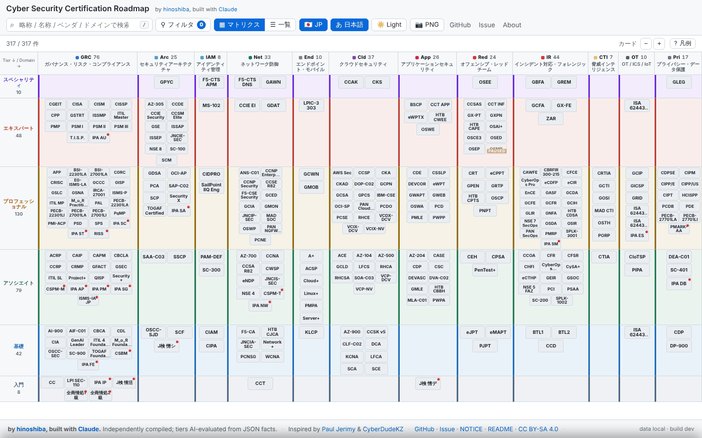
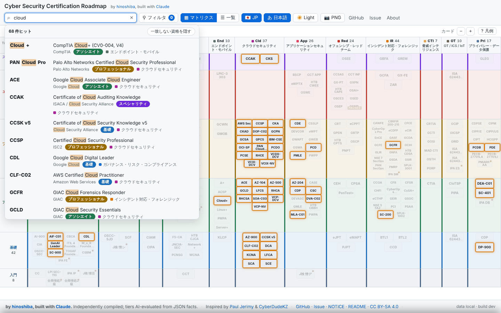
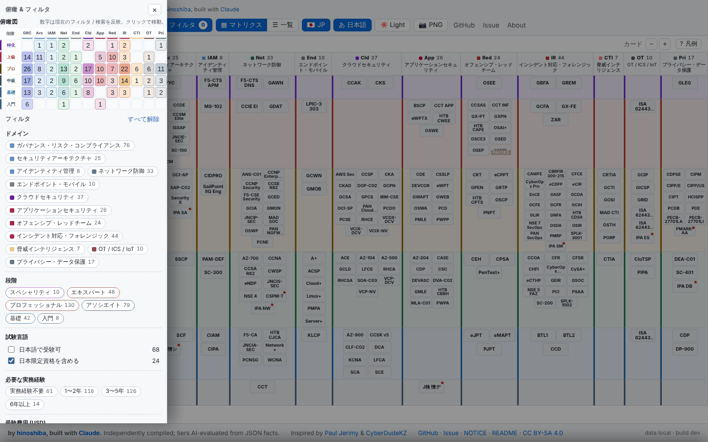
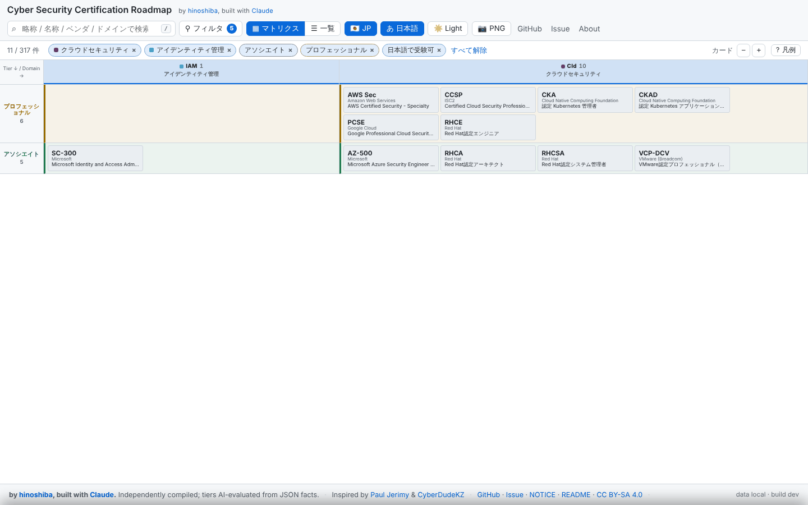
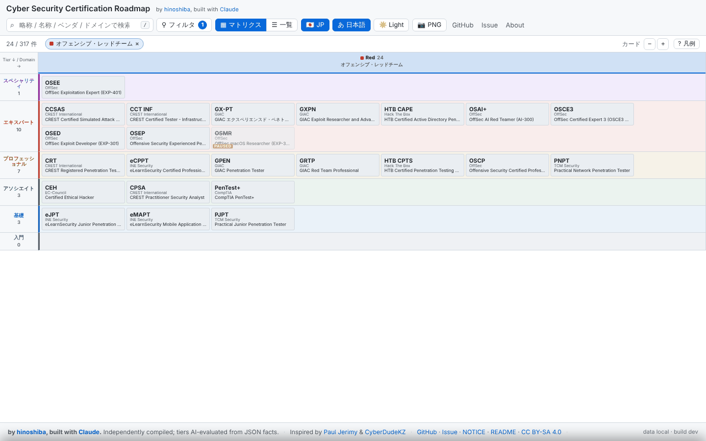
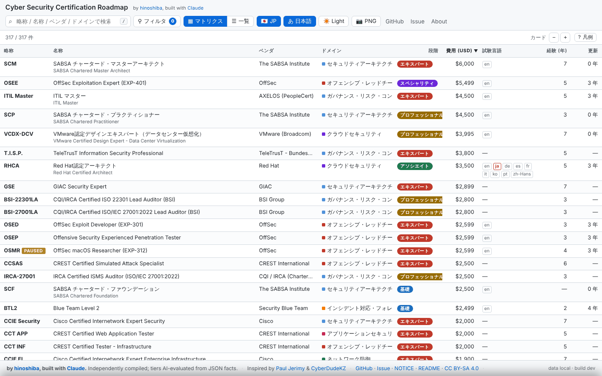
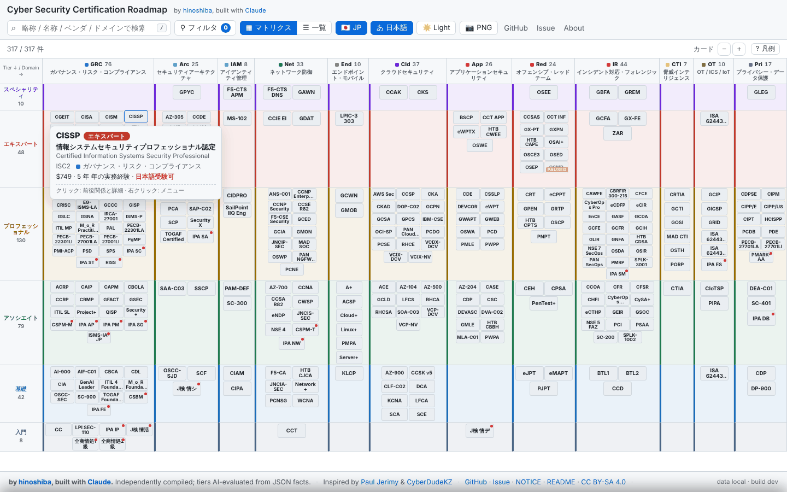
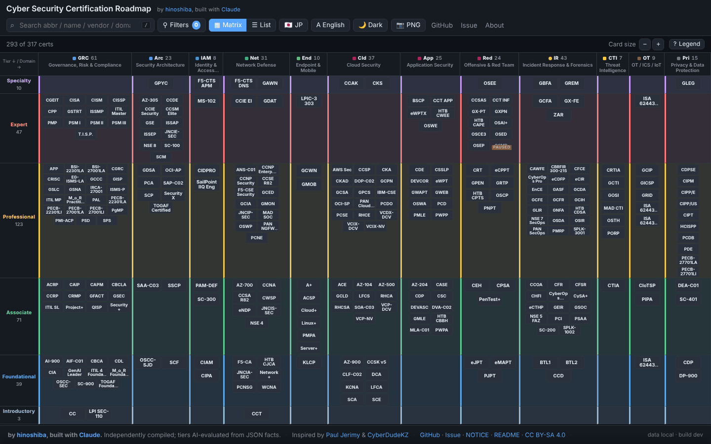

# UX research: search & overview redesign (2026-10)

_English first, 日本語は後半。_

## Why

The owner's complaint, verbatim: "検索もしづらいし、俯瞰的にもみづらい" — search is hard
to use and the roadmap is hard to take in at a glance. This note records what we
found when we examined the live site, what comparable roadmaps do, who the users
are, and which requirements the redesign implements. It is the "why" behind the
UI code in `assets/`.

## Method

1. Drove the live site (`?theme=light&lang=ja&jp=1`) in headless Chromium at
   1920 / 1440 / 1280 / 390 px, light and dark, EN and JA, with search, a
   selection, the vendor panel and the detail panel open.
2. Read every UI module (`assets/js/*.js`, `assets/css/styles.css`) and the data
   shape (317 certs, 68 vendors, 12 domains, 6 tiers; 68 certs with a Japanese
   exam, 24 Japan-only, 298 with a USD price).
3. Looked at the two roadmaps this project credits (Paul Jerimy, CyberDudeKZ)
   for the interaction patterns their users already expect.

## Personas

| Persona | Goal on this site | What they need from the UI |
| --- | --- | --- |
| **Newcomer** (student / career changer) | "Which cert should I start with?" | Entry tiers only, cheap exams, exams in their language, plain names not acronyms |
| **Practitioner** (2–6 yrs, one domain) | "What is my next step in cloud / IR / pentest?" | One domain at a time, the prerequisite path, cost & experience bands |
| **Manager / CISO** | "Map a team's certs; what is senior in GRC?" | Tier × domain overview, vendor breadth, sortable comparison table |
| **JP enterprise engineer** | "Where do IPA / SEA-J certs sit next to CISSP?" | Japan-only toggle, Japanese-exam filter, JA labels everywhere, JA names searchable |

## Pain points observed (before)

| # | Observation | Evidence |
| --- | --- | --- |
| P1 | Search only highlighted cards in place; no result list. With "cloud" the user had to hunt 30 orange borders across 1400 px. | [`screenshots/before-search.png`](./screenshots/before-search.png) |
| P2 | Search matched only abbr / name / vendor. Typing a domain ("クラウド"), a tier ("expert") or a cert id found nothing. | `search.js` (old) |
| P3 | No ranking: an exact abbreviation ("CCSP") and a substring hit ranked the same; Enter only worked when exactly one card matched. | `app.js` (old) |
| P4 | Only filter was a vendor checklist in a dropdown; no domain, tier, language, cost or experience facets. | `filter.js` (old) |
| P5 | The tier × domain heat map ("俯瞰図") existed only on phones. On desktop the only overview was the 317-card wall itself; at 1280 × 720 it needed scrolling and there was nothing to navigate by. | [`screenshots/before-laptop-1280.png`](./screenshots/before-laptop-1280.png) |
| P6 | Cards show the abbreviation only; the full name lived in a slow native `title` tooltip. Long abbreviations were clipped ("ISA 62443..", "M_o_R Practiti..."). | [`screenshots/before-desktop.png`](./screenshots/before-desktop.png) |
| P7 | Domain headers wrapped mid-word in Japanese and showed no counts; tier rows showed no counts. | [`screenshots/before-desktop.png`](./screenshots/before-desktop.png) |
| P8 | No tabular view: nothing could be sorted by cost, experience, renewal or language. | — |
| P9 | A cryptic "ベンダ強調: 資格数 [0] 件以上" number box sat in the main controls bar; the legend was a 200-character line. | [`screenshots/before-desktop.png`](./screenshots/before-desktop.png) |
| P10 | The `あ Lang` / `🇯🇵 JP` buttons were ambiguous (label language vs. Japan-only certs). | `index.html` (old) |

## What comparable roadmaps do

- **Paul Jerimy**: a single dense chart, search box with highlight, a category
  dropdown. Readers like the one-screen "shape"; they struggle to find a specific
  cert. Lesson: keep the one-screen matrix, add a real finder.
- **CyberDudeKZ**: facet rows for level / format / cost / experience, a vendor
  legend, search by name or vendor, horizontal scroll. Lesson: facets with
  counts are the expected way to narrow 500 certs; cost and experience bands
  are what people filter on.

## Requirements → implementation

| Req | Implementation | Where |
| --- | --- | --- |
| R1 Ranked, readable search results | Type-ahead list (abbr · name · vendor · tier · domain), exact abbr > prefix > substring; ↑↓ Enter Esc; `/` or Ctrl+K to focus | `search.js`, `search_palette.js` |
| R2 Search every label a user might type | abbr, id, name, name_ja, vendor, domain & tier labels in EN/JA | `search.js` |
| R3 Search can also *filter* | "Hide non-matches" toggle (`?qf=1`) removes non-hits from the matrix / list; hit counts shown per overview cell | `facets.js`, `overview.js` |
| R4 Facets with live counts | Domain · tier · Japanese-exam · Japan-only · experience bands · cost bands · vendor (searchable), each with "what clicking it leaves" counts; removable active-filter chips; `F` toggles the panel | `facets.js`, `filter_panel.js` |
| R5 Overview on desktop | The heat map lives in the side panel (docked ≥ 1600 px, overlay below so the one-screen matrix is never squeezed); counts follow filters/search; click = scroll & flash the cell (list view: drill down) | `overview.js`, `app.js` |
| R6 Focus one domain | Click a column header → only that domain; cards widen to show vendor + full name | `render.js`, `styles.css` (`few-domains`) |
| R7 Readable cards | Fast custom tooltip (name, vendor, tier, domain, cost, JA exam); card size control (`?z=s|m|l`, large shows vendor); tier/domain headers carry counts | `tooltip.js`, `styles.css` |
| R8 Compare & sort | List view (`?view=list`), sortable by abbr / name / vendor / domain / tier / cost / exam languages / experience / renewal; same filters, same detail panel | `list_view.js` |
| R9 Calmer chrome | Vendor-highlight threshold moved into the vendor facet; legend + keyboard shortcuts in a "?" popover; explicit "A English / あ 日本語" label toggle; tooltips on JP / theme buttons | `index.html`, `i18n.js` |
| R10 Everything bookmarkable | All of the above is URL state (`d t v xja exp cost q qf view sort z vt`) | `url_state.js` |

Out of scope for this round (candidates for later): saving a personal path,
comparing two certs side by side, a "show secondary domains too" switch for the
domain facet, and per-domain colour themes for the matrix columns.

## Screenshots (after)

| | |
| --- | --- |
|  |  |
|  |  |
|  |  |
|  |  |

---

# UX 調査: 検索と俯瞰性の再設計 (2026-10)

## 背景

オーナーからの指摘は「検索もしづらいし、俯瞰的にもみづらい」。本ノートは、
公開サイトの観察、参考ロードマップの比較、想定ユーザー、そして今回の再設計で
実装した要件をまとめたもの。`assets/` の UI コードの「なぜ」にあたる。

## 調査方法

1. 公開サイト (`?theme=light&lang=ja&jp=1`) をヘッドレス Chromium で
   1920 / 1440 / 1280 / 390 px、ライト / ダーク、EN / JA、検索中・選択中・
   ベンダパネル・詳細パネル表示の各状態で撮影。
2. UI モジュール (`assets/js/*.js`, `assets/css/styles.css`) とデータの形
   (317 資格、68 ベンダ、12 ドメイン、6 段階、日本語受験可 68、日本限定 24、
   USD 価格あり 298) を精読。
3. 本プロジェクトが敬意を表する 2 つのロードマップ (Paul Jerimy, CyberDudeKZ)
   の操作パターンを確認。

## ペルソナ

| ペルソナ | 目的 | UI に必要なもの |
| --- | --- | --- |
| **入門者** (学生 / 転職者) | 「最初にどれを取る?」 | 入門〜基礎だけ、安価、母語で受験可、略称でなく正式名 |
| **実務者** (2〜6 年、1 ドメイン) | 「クラウド / IR / ペンテストの次の一手は?」 | 1 ドメインに集中、前提の経路、費用・経験年数の帯 |
| **マネージャ / CISO** | 「チームの資格を地図に。GRC の上級は?」 | 段階 × ドメインの俯瞰、ベンダの幅、並べ替え可能な比較表 |
| **国内エンタープライズのエンジニア** | 「IPA / SEA-J は CISSP と並べるとどこ?」 | 日本限定トグル、日本語受験フィルタ、全面 JA ラベル、JA 名称で検索 |

## 観察された課題 (改善前)

| # | 観察 | 根拠 |
| --- | --- | --- |
| P1 | 検索は該当カードを光らせるだけで結果一覧がない。「cloud」で 30 件のオレンジ枠を 1400px の中から探す必要があった。 | [`screenshots/before-search.png`](./screenshots/before-search.png) |
| P2 | 検索対象は略称 / 名称 / ベンダのみ。ドメイン (「クラウド」)、段階 (「expert」)、ID は検索不可。 | 旧 `search.js` |
| P3 | 関連度順がなく、略称完全一致と部分一致が同列。Enter は一致が 1 件の時だけ動作。 | 旧 `app.js` |
| P4 | フィルタはドロップダウンのベンダ一覧のみ。ドメイン・段階・言語・費用・経験年数の絞り込みがない。 | 旧 `filter.js` |
| P5 | 俯瞰図 (段階 × ドメインのヒートマップ) はスマホ専用。デスクトップでは 317 枚のカードの壁そのものが唯一の俯瞰で、1280×720 ではスクロールが必要なのに道しるべがない。 | [`screenshots/before-laptop-1280.png`](./screenshots/before-laptop-1280.png) |
| P6 | カードは略称のみ。正式名称は表示の遅いネイティブ `title` 頼み。長い略称は途中で切れる ("ISA 62443..", "M_o_R Practiti...")。 | [`screenshots/before-desktop.png`](./screenshots/before-desktop.png) |
| P7 | ドメイン見出しが日本語で単語の途中で折り返し、件数もない。段階行にも件数がない。 | [`screenshots/before-desktop.png`](./screenshots/before-desktop.png) |
| P8 | 表形式がなく、費用・経験年数・更新・言語で並べ替えできない。 | — |
| P9 | 意味の分かりにくい「ベンダ強調: 資格数 [0] 件以上」の数値入力がメインのバーに常駐し、凡例が 200 文字の一行。 | [`screenshots/before-desktop.png`](./screenshots/before-desktop.png) |
| P10 | `あ Lang` / `🇯🇵 JP` ボタンが紛らわしい (表示言語か、日本限定資格の表示か)。 | 旧 `index.html` |

## 参考ロードマップの流儀

- **Paul Jerimy**: 1 枚の高密度チャート、ハイライト検索、カテゴリのドロップダウン。
  一画面で「全体の形」が見える点は好まれるが、特定の資格を探すのは難しい。
  → 一画面マトリクスは維持し、本物の検索を足す。
- **CyberDudeKZ**: レベル / 形式 / 費用 / 経験年数のファセット行、ベンダ凡例、
  名称・ベンダ検索、横スクロール。→ 件数付きファセットが 500 件を絞る常道で、
  費用と経験年数が実際に使われる軸。

## 要件 → 実装

| 要件 | 実装 | 場所 |
| --- | --- | --- |
| R1 関連度順で読める検索結果 | 入力補完リスト (略称 · 名称 · ベンダ · 段階 · ドメイン)、略称完全一致 > 前方一致 > 部分一致、↑↓ Enter Esc、`/` または Ctrl+K でフォーカス | `search.js`, `search_palette.js` |
| R2 ユーザーが打ちそうな全ラベルを検索 | 略称、ID、名称、日本語名、ベンダ、ドメイン・段階ラベル (EN/JA) | `search.js` |
| R3 検索を絞り込みにも使える | 「一致しない資格を隠す」トグル (`?qf=1`)、俯瞰図のセルにヒット件数表示 | `facets.js`, `overview.js` |
| R4 件数付きファセット | ドメイン · 段階 · 日本語受験可 · 日本限定 · 経験年数帯 · 費用帯 · ベンダ (検索可)。各値に「押した後に残る件数」、取り外せる適用中チップ、`F` で開閉 | `facets.js`, `filter_panel.js` |
| R5 デスクトップでも俯瞰 | ヒートマップをサイドパネルに (≥1600px でドック、それ未満はオーバーレイで一画面マトリクスを潰さない)。件数はフィルタ / 検索に追従。クリックでセルへスクロール + 点滅 (一覧表示ではドリルダウン) | `overview.js`, `app.js` |
| R6 1 ドメインに集中 | 列見出しクリックでそのドメインのみ表示。カードが広がりベンダ + 正式名を表示 | `render.js`, `styles.css` (`few-domains`) |
| R7 読めるカード | 高速なカスタムツールチップ (名称、ベンダ、段階、ドメイン、費用、日本語受験可)、カードサイズ (`?z=s|m|l`、大でベンダ表示)、段階 / ドメイン見出しに件数 | `tooltip.js`, `styles.css` |
| R8 比較と並べ替え | 一覧表示 (`?view=list`)。略称 / 名称 / ベンダ / ドメイン / 段階 / 費用 / 試験言語 / 経験 / 更新で並べ替え。同じフィルタ・同じ詳細パネル | `list_view.js` |
| R9 落ち着いたクローム | ベンダ強調しきい値をベンダファセット内へ、凡例とショートカットを「?」ポップオーバーへ、表示言語ボタンを「A English / あ 日本語」に明示、JP / テーマボタンにツールチップ | `index.html`, `i18n.js` |
| R10 すべてブックマーク可能 | 上記すべてが URL 状態 (`d t v xja exp cost q qf view sort z vt`) | `url_state.js` |

今回の対象外 (次の候補): 自分の取得計画の保存、2 資格の並列比較、ドメイン
ファセットで副ドメインも含めるスイッチ、列ごとのドメイン配色テーマ。

## スクリーンショット (改善後)

上の英語セクション末尾の表を参照 (`docs/screenshots/after-*.png`)。改善前は `before-*.png`。
